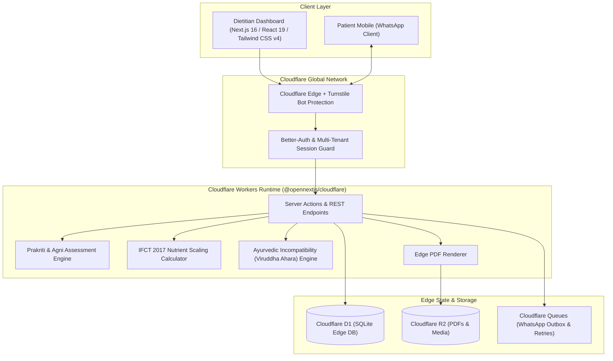

# BrightLoom Application Development Plan
### Cloud-Based Practice Management & Nutrient Analysis Software for Ayurvedic Dietitians

**Version:** 1.0.0  
**Target Architecture:** Next.js 16 (React 19) • Cloudflare Workers (`@opennextjs/cloudflare`) • Cloudflare D1 (SQLite) • Drizzle ORM • Better-Auth • Cloudflare Queues/R2  
**Engineering Standards:** Zero Automatic Git Push • Continuous Testing Triad (Unit, Integration, E2E) • Multi-Tenant Isolation • Adversarial Security Review  

---

## 1. Executive Summary & Core Value Proposition

BrightLoom for Ayurvedic Dietitians bridges the critical gap between traditional Ayurvedic medicine (*Prakriti*, *Agni*, *Guna*, *Rasa*, and *Ritucharya*) and modern scientific nutrient quantification.

### The Problem It Solves
- **Western Nutrition Software** calculates calories and macros but treats all bodies identically, missing digestive fire capacity (*Agni*), metabolic constitution (*Prakriti*), and seasonal disharmony.
- **Traditional Ayurvedic Practice** relies on manual, paper-based diet charts, subjective assessments, and non-standardized nutrient tracking, taking 30–40 minutes per patient consultation.
- **BrightLoom Solution:** A unified edge SaaS combining the **ICMR-NIN (National Institute of Nutrition) Indian Food Composition Tables (IFCT 2017)** with an automated Ayurvedic rule engine, reducing diet creation to 5–10 minutes with instant PDF generation and automated WhatsApp delivery.

### Top 5 Core Capabilities
1. **Constitutional Assessment Engine:** Standardized multi-factor clinical diagnosis determining *Prakriti*, *Vikriti*, and *Agni* status.
2. **Dual-Engine Food & Nutrient Database:** 528+ IFCT Indian foods indexed with both biochemical nutritional metrics (kcal, protein, carbs, fats, fiber, minerals) and Ayurvedic energetic attributes (*Rasa*, *Virya*, *Vipaka*, *Guna*, *Dosha Karma*).
3. **Smart Diet Chart Builder & Incompatibility Checker:** Drag-and-drop meal schedule creator with real-time nutrient scaling and automated *Viruddha Ahara* (incompatible food) conflict alerts.
4. **Longitudinal Progress & Consultation Monitoring:** Multi-visit tracking of anthropometrics (weight, BMI), digestive fire normalization, and symptom reduction trends.
5. **Practice CRM & WhatsApp Automation:** Clinic management with role-based access, appointment scheduling, and automated PDF delivery over WhatsApp Business Cloud API.

---

## 2. Phase Breakdown: How the Work is Divided

The project is structured into **5 distinct, sequential phases**. Each phase contains explicit deliverables, technical components, and verification gates adhering to the **Continuous Testing Triad** (Unit, Integration, E2E) and adversarial testing rules from `AGENTS.md`.

```
┌────────────────────────────────────────────────────────────────────────────────────────┐
│                               PHASE DIVISION OVERVIEW                                  │
├─────────┬──────────────────────────────┬───────────────┬───────────────────────────────┤
│ Phase   │ Name                         │ Duration      │ Core Milestone Focus          │
├─────────┼──────────────────────────────┼───────────────┼───────────────────────────────┤
│ Phase 1 │ Foundation & Data Layer      │ Weeks 1 - 2   │ D1 Schema, IFCT Seeding, Auth │
│ Phase 2 │ Clinical Assessment Engine   │ Weeks 3 - 4   │ Prakriti & Agni Scoring Engine│
│ Phase 3 │ Diet Builder & Nutrient Math │ Weeks 5 - 6   │ IFCT Scaling & Viruddha Flags │
│ Phase 4 │ Progress, PDF & WhatsApp     │ Weeks 7 - 8   │ Longitudinal Graphs, R2, Queue│
│ Phase 5 │ Hardening, Audit & Release   │ Weeks 9 - 10  │ Triad Tests, Concurrency & Ship│
└─────────┴──────────────────────────────┴───────────────┴───────────────────────────────┘
```

---

### Detailed Phase Breakdown

#### Phase 1: Foundation & Data Infrastructure (Weeks 1 – 2)
*Goal: Establish edge database models, seed clinical datasets, and configure tenant security.*
- **1.1 Database Schema Extensions:**
  - Create Drizzle models in `src/lib/db/schema.ts` for `patients`, `food_items`, `diet_plans`, `meal_items`, and `consultations`.
  - Enforce foreign keys, cascade deletes, and composite indices on `(organization_id, id)` and `(organization_id, phone)`.
  - Apply migrations locally to Cloudflare D1 via Wrangler (`wrangler d1 migrations apply brightloom-d1 --local`).
- **1.2 Nutrition & Ayurveda Dataset Seeding:**
  - Ingest the ICMR-NIN Indian Food Composition Tables (IFCT 2017) baseline dataset (528+ common Indian foods, cereals, pulses, vegetables, spices).
  - Seed Ayurvedic properties for each food: *Rasa* (6 tastes), *Virya* (Ushna/Sheeta), *Vipaka*, and effects on Vata/Pitta/Kapha.
- **1.3 Multi-Tenant Access Control & Better-Auth Guards:**
  - Extend session validation to ensure all patient and clinical reads/writes are scoped strictly to the authenticated `organizationId`.
- **Phase 1 Verification:**
  - Unit tests verifying Drizzle schema constraints and seeding integrity.
  - Integration tests verifying tenant isolation (Organization A cannot query Organization B's food overrides or patients).

---

#### Phase 2: Ayurvedic Clinical Assessment Engine (Weeks 3 – 4)
*Goal: Provide dietitians with a rapid, standardized diagnostic intake workflow.*
- **2.1 Prakriti & Vikriti Assessment Questionnaire:**
  - Build interactive 30-parameter clinical assessment (body frame, skin texture, appetite, digestion, sleep, stress response, elimination).
  - Implement mathematical scoring algorithm outputting primary and secondary dosha balance percentages (e.g., Vata 45%, Pitta 35%, Kapha 20%).
- **2.2 Agni & Digestive Capacity Diagnostic:**
  - Clinical classifier evaluating *Agni* state (*Manda* / slow, *Tikshna* / sharp, *Visham* / irregular, *Sama* / balanced).
  - Assessment of *Koshtha* (bowel movement pattern: *Krura*, *Madhyama*, *Mrudu*).
- **2.3 Patient Record Management UI:**
  - Patient directory with instant search, filtering by Dosha type, phone number, and active plan status.
  - Patient detail dashboard presenting historical consultations and current treatment goals.
- **Phase 2 Verification:**
  - Unit tests for the Prakriti scoring matrix with diverse diagnostic edge cases.
  - Form validation tests ensuring null/empty clinical fields fail gracefully with user-friendly alerts.

---

#### Phase 3: Interactive Diet Chart Builder & Nutrient Scaler (Weeks 5 – 6)
*Goal: Core value module — dynamic meal planning combining biochemical calculations and Ayurvedic compatibility.*
- **3.1 Real-Time Nutrient Calculation Engine:**
  - Implement portion-scaling algorithm converting raw/cooked ingredient weights (grams) into Energy (kcal), Protein (g), Carbohydrates (g), Fats (g), and Fiber (g).
  - Compare meal totals against ICMR-NIN Recommended Dietary Allowances (RDA) calibrated by patient age, gender, and activity level.
- **3.2 Ayurvedic Compatibility & Incompatibility (*Viruddha Ahara*) Checker:**
  - Automated warning system identifying incompatible combinations (e.g., milk + fish, milk + sour fruits, heated honey).
  - Dosha-aggravation alerts (e.g., warning if high-Pitta patient is assigned pungent/sour/salty spicy dishes in summer/*Grishma*).
- **3.3 Meal Plan Assembly UI:**
  - Slot-based meal planner: *Pratah* (Morning/Breakfast), *Madhyahna* (Lunch), *Sandhya* (Evening Snack), *Ratri* (Dinner).
  - Recipe and item search modal with instant nutrient previews and one-click item addition.
- **Phase 3 Verification:**
  - Unit tests comparing software-calculated nutritional totals against manually verified ICMR-NIN reference plans.
  - Rule-engine tests confirming 100% detection of predefined *Viruddha Ahara* combinations.

---

#### Phase 4: Longitudinal Monitoring, PDF Export & WhatsApp Automation (Weeks 7 – 8)
*Goal: Transform plans into patient-facing deliverables and track clinical progress over time.*
- **4.1 Edge-Compatible PDF Diet Chart Generator:**
  - Generate clean, print-ready, branded PDF diet charts with clinic logo, meal timings, dietary guidelines, and specific do's/don'ts (*Pathya & Apathya*).
  - Upload generated charts to Cloudflare R2 object storage with pre-signed secure access URLs.
- **4.2 WhatsApp Business Cloud API Delivery:**
  - Wire diet plan dispatching into the existing Cloudflare Outbox queue (`outboxJobs`).
  - Send formatted WhatsApp messages with download links or direct PDF documents to the patient's verified phone number.
- **4.3 Longitudinal Progress Tracking Dashboard:**
  - Follow-up consultation logging: weight changes, BMI trajectory, symptom alleviation, and Agni normalization.
  - Interactive visual trend charts comparing patient biomarkers over time.
- **Phase 4 Verification:**
  - Integration tests verifying Cloudflare Queue delivery and retry backoff mechanics.
  - PDF rendering tests validating formatting across desktop and mobile screens.

---

#### Phase 5: Quality Assurance, Security Hardening & Production Release (Weeks 9 – 10)
*Goal: Rigorous adversarial audit, performance verification under load, and production deployment.*
- **5.1 The Continuous Testing Triad Execution:**
  - **Unit Tests:** Business logic, scaling helpers, Prakriti calculators, and parsing logic.
  - **Integration Tests:** Edge D1 queries, Better-Auth session validation, and Cloudflare Queue consumers.
  - **E2E Journey Tests (Playwright):** Full user flows: Login $\rightarrow$ Onboard Clinic $\rightarrow$ Register Patient $\rightarrow$ Diagnose Prakriti $\rightarrow$ Build Plan $\rightarrow$ Export PDF.
- **5.2 Adversarial Review ("Attack Your Own Work"):**
  - **Injection & Sanitization:** SQL injection resistance on D1, XSS protection in PDF generation, and strict Zod payload validation.
  - **Authorization & IDOR:** Prevent User A from viewing or modifying Patient records of User B.
  - **Concurrency & Stress:** Simulate rapid D1 database writes and simultaneous queue jobs to confirm SQLite lock safety.
- **5.3 Deployment & Verification:**
  - Validate bundle sizes and edge execution times on Cloudflare Workers.
  - Confirm Zero-Push policy compliance (local tests 100% green before explicit deployment approval).

---

## 3. System Architecture & Tech Stack



---

## 4. Database Schema Structure (Cloudflare D1 / Drizzle)

```
organizations (Tenants / Clinics)
  ├── users & organization_members (RBAC: Dietitian, Doctor, Admin)
  ├── patients (Demographics, Prakriti, Agni, Koshtha, Health History)
  │     ├── consultations (Visit notes, symptoms, treatment goals)
  │     ├── progress_logs (Anthropometrics: Weight, BMI, Waist, Agni status)
  │     └── diet_plans (Active/archived meal plans, season, target calories)
  │           └── meal_items (Meal slot, portion grams, food_item_id, notes)
  ├── food_items (IFCT 2017 calories, macros, micros + Rasa, Virya, Vipaka, Dosha effects)
  └── outbox_jobs (Queue for WhatsApp delivery, webhook retries)
```

---

## 5. Potential Risks & Engineering Mitigations

1. **D1 SQLite Write Concurrency:**
   - *Risk:* Heavy concurrent writes during peak consultation hours could trigger `SQLITE_BUSY`.
   - *Mitigation:* Read operations query distributed edge replicas. Asynchronous tasks (WhatsApp delivery, audit logging) are offloaded to Cloudflare Queues / Outbox jobs.
2. **Ayurvedic Rule Standardization:**
   - *Risk:* Discrepancies between different Ayurvedic classical texts (*Charaka Samhita* vs. *Sushruta Samhita*).
   - *Mitigation:* Rules provide intelligent clinical recommendations with explicit practitioner overrides rather than unbendable hard blocks.
3. **Edge Worker Execution Budget:**
   - *Risk:* Complex PDF rendering exceeding Cloudflare Worker isolate CPU/memory limits.
   - *Mitigation:* Utilize lightweight streaming vector/canvas PDF engines (`pdf-lib`) and store static assets in Cloudflare R2.
4. **Data Privacy & Multi-Tenant Isolation:**
   - *Risk:* Accidental data leakage between competing clinics using the SaaS.
   - *Mitigation:* Every database query is strictly filtered through `where(and(eq(table.organizationId, tenantOrgId), ...))` using centralized tenant query helpers.

---

## 6. Implementation Summary Table

| Phase | Milestone Name | Weeks | Key Deliverables |
| :--- | :--- | :--- | :--- |
| **Phase 1** | Foundation & Data Layer | 1 – 2 | D1 clinical tables, IFCT 2017 dataset seed, multi-tenant RBAC |
| **Phase 2** | Clinical Assessment Engine | 3 – 4 | Prakriti scoring algorithm, Agni/Koshtha intake, patient profile UI |
| **Phase 3** | Diet Builder & Nutrient Math | 5 – 6 | Meal slot planner, real-time macro/micro scaler, *Viruddha Ahara* alerts |
| **Phase 4** | Progress, PDF & WhatsApp | 7 – 8 | PDF chart generator, Cloudflare R2 upload, WhatsApp dispatch queue, trend graphs |
| **Phase 5** | Hardening, Audit & Release | 9 – 10 | Testing Triad (Unit/Integration/Playwright), security & stress audit, Cloudflare deployment |

